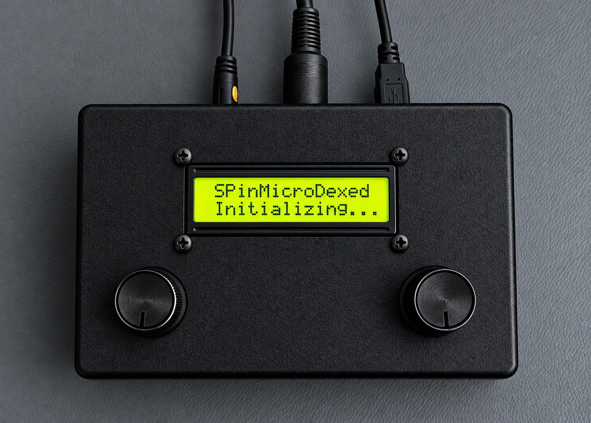
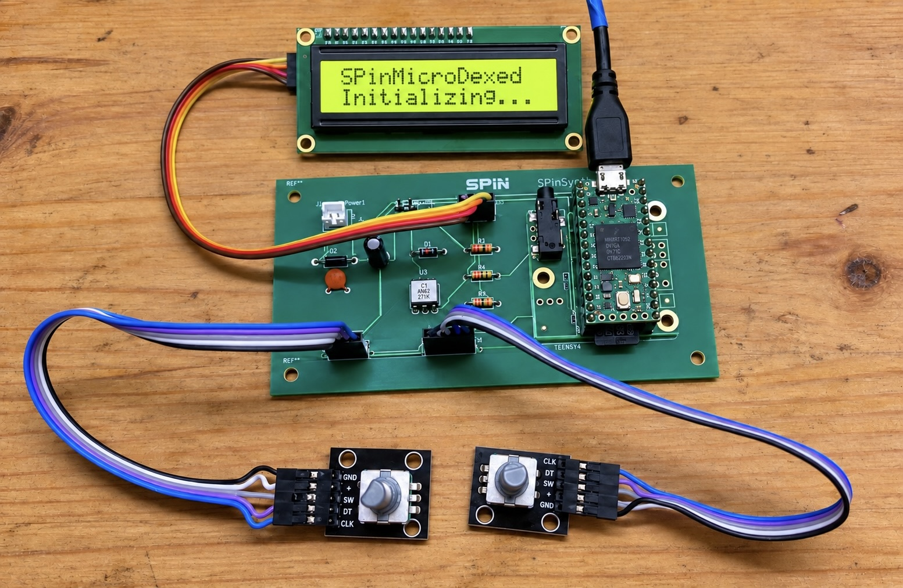

# SPinMicroDexed hardware assembly

The [SPinSynth-T-LCD circuit diagram](hardware/SPinSynth-T-LCD-Hardware.pdf)
is included with the hardware documentation. See also the
[hardware baseline notes](SPINSYNTH_T_LCD_HARDWARE.md).

## Assembly update — 5 October 2026

Ricardo Peculis reports that the ribbon-cable contacts have been stabilized,
the hardware is working, and the complete instrument is now assembled inside
its plastic housing. This resolves the connector instability discussed during
the earlier assembly tests. No new firmware change or endurance-test result is
recorded by this update.

## Instrument in its housing

The supplied enclosure image shows the LCD, two rotary-encoder knobs, and
external cable connections, with the SPinMicroDexed initialization screen.

## Earlier assembly outside the enclosure

This earlier bench photograph records the PCB, Teensy assembly, LCD, and
encoder wiring before installation in the enclosure. It is retained as an
assembly reference, rather than a photograph of the final internal layout.

Both images were supplied by Ricardo Peculis and are preserved in their
original file formats.
